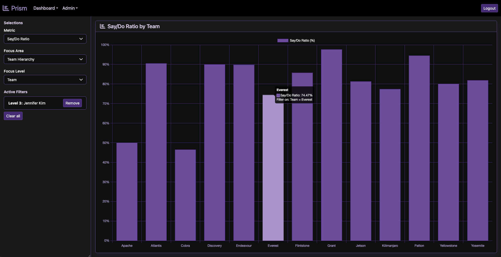

# Prism

**Drill-down analytics for software delivery metrics.** Pick a metric (Say/Do ratio, scope churn, velocity …), then
slice it by time or by organization and click any bar to drill in: company → division → manager → team, or year →
quarter → month → sprint. New metrics are added as **data, not code**: no new screens or endpoints.



> **Status: working prototype.** Five demo metrics with drill-down, user administration, and the first version of
> the Prism Advisor (an MCP server). Authentication is next on the roadmap; until then, run it locally only.

## What's interesting here

- **Metrics are metadata.** A metric is a row in a table: a type (percentage, ratio, average or sum), a numerator,
  an optional denominator and row condition, and display settings. The server writes every query from that
  metadata; the browser sends only IDs and values, never SQL. →
  [Architecture & design](REST/docs/OVERVIEW.md)
- **Ratios are always right at every level.** Prism stores counts, never percentages, and recalculates from the
  raw rows at every drill-down level. Two teams at 90 % (9 of 10) and 25 % (10 of 40) are **38 %** together, not
  the 57.5 % an average of percentages would show.
- **Calculation changes are proven, not assumed.** When the query engine was rewritten, every metric × level ×
  filter combination was run through the old and new paths: **24,160 cases, 120,580 rows, 0 differences**, and a
  deliberate rounding change was caught in 11,792 cases. That became a permanent check: a hand-worked edge-case
  dataset, 23,557 cases compared with a frozen baseline, and a deliberately wrong calculation that must be
  detected. → [Metric parity check](REST/tools/parity/README.md)
- **An AI advisor that knows Prism's rules.** The Prism Advisor is an MCP server (Spring AI) that helps teams get
  value out of Prism: guides, a catalog of 15 metrics with their pitfalls, and tools that turn a metric idea into a
  valid Prism definition with the exact SQL it would run. → [MCP design](REST/docs/MCP.md)

## Architecture

| Layer | Technology |
|---|---|
| UI | React 19, TypeScript, Vite, Bootstrap 5, Chart.js |
| API | Spring Boot 3.5, Java 21, JdbcTemplate (raw SQL, generated from metadata) |
| Data | PostgreSQL STAR schema: fact tables with numerator/denominator columns, time and organization dimensions |
| AI | MCP server (Spring AI 1.1, Streamable HTTP): resources, tools and a metric catalog |
| Build | Maven, npm; Jenkins pipeline in [`REST/ci/Jenkinsfile`](REST/ci/Jenkinsfile) |

```
REST/          Spring Boot API, React UI (REST/frontend), docs, parity check (REST/tools/parity)
SQL/           numbered migration scripts (001 star schema … 012 metric types) and setup.sh
docs/          README images and the AI workflow record (docs/ai-workflow)
```

## Run it

Prerequisites: Java 21, Node 20+, PostgreSQL 16 (on a Mac, [Postgres.app](https://postgresapp.com) works).

```bash
# 1. Database: creates "playpen" and runs every migration, including the demo data
PGPASSWORD=<your postgres password> bash SQL/setup.sh

# 2. Build (frontend, then the jar) and run
cd REST
./build.sh
PGPASSWORD=<your postgres password> ./run.sh          # http://localhost:8080

# 3. First user: the API creates it with a one-time temporary password (there is no default password)
curl -s -X POST http://localhost:8080/api/users -H 'Content-Type: application/json' \
     -d '{"enterprise_pk": 1, "email": "you@example.com"}'
```

Sign in at http://localhost:8080 with that email and the `temporaryPassword` from the response, then choose your
own password.

Optional:

- **Prism Advisor (MCP):** `./run.sh --prism.mcp.enabled=true`, then connect an MCP client to
  `http://localhost:8080/mcp` (e.g. `npx @modelcontextprotocol/inspector`). Local requests only.
- **Parity check:** `PGPASSWORD=… bash tools/parity/run.sh` (from `REST/`).

## How this was built

Prism is built with Claude as a pair programmer, under explicit engineering rules:

- **Conventions and guardrails the AI works within:** [`REST/CLAUDE.md`](REST/CLAUDE.md) holds the stack, the source
  map, coding and logging conventions, database rules (numbered, re-runnable migrations only) and a numbered
  backlog. Every session starts from it and [the roadmap](REST/docs/ROADMAP.md), and updates both.
- **Decisions stay with the owner.** Design choices such as metric types, the fact-table grain rule, naming and
  what Prism recommends to its users are made by the owner and written down; the AI drafts, implements and checks.
- **Proof before trust.** Any change that could affect a calculated value must pass the parity check with zero
  differences. Code is compiled with warnings as errors, and tests run before anything is handed over.
- **The record:** [`docs/ai-workflow/`](docs/ai-workflow/README.md) has a readable summary of an early design
  session and the full transcripts.

## For developers

- [API codebase guide](REST/CLAUDE.md): source map, endpoints, conventions, backlog
- [UI developer guide](REST/frontend/docs/DEVELOPER_GUIDE.md)
- [Roadmap](REST/docs/ROADMAP.md): what's next, in order
- [Architecture & design](REST/docs/OVERVIEW.md) · [MCP design](REST/docs/MCP.md) · [Parity check](REST/tools/parity/README.md)

The demo data is generated: all names, teams and numbers are invented.
