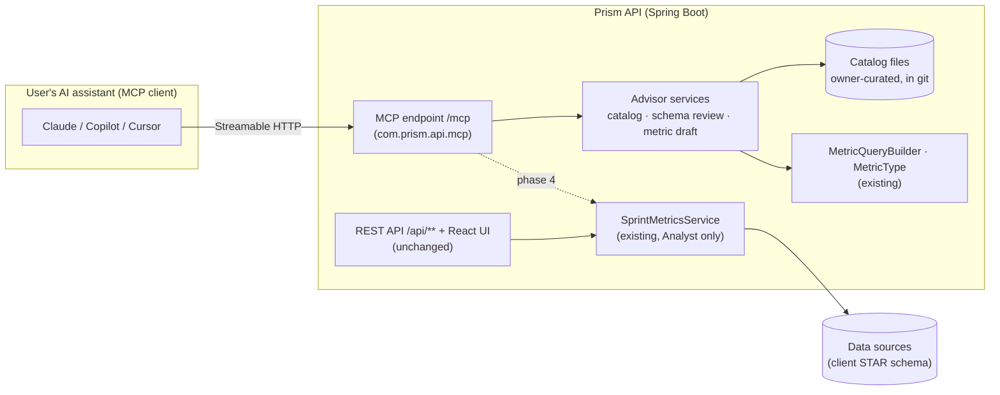

# Prism and MCP — Design

> How an MCP server fits into Prism. **Why** (the product vision: Advisor, community library, improvement paths,
> "what drives this?") is in [OVERVIEW.md §8](OVERVIEW.md);
> **what to build next** is in [ROADMAP.md](ROADMAP.md). This file is the technical design: where the server
> runs, what it exposes, the safety rules, and the phases.
>
> Status: **phase 1 complete (Oct 2026, merged from `feature-MCP-Server` and `feature-MCP-Server-P2`)**: the `/mcp`
> endpoint, the guides and metric catalog as resources, the three tools and the three prompts (§7); content
> reviewed by the owner. Decisions still open are marked _Open_.

_Last updated: 2026-10-24._

---

## 1. What MCP adds to Prism

[MCP](https://modelcontextprotocol.io) (Model Context Protocol) is the standard way for AI assistants (Claude,
Copilot, Cursor and others) to use an outside system. A server offers three kinds of things:

| MCP part | Meaning | In Prism |
|---|---|---|
| **Resources** | Read-only content the assistant can load | Metric catalog, guides, improvement paths |
| **Tools** | Functions the assistant can call, with typed inputs and outputs | Schema review, metric drafting; later metric data |
| **Prompts** | Named, reusable workflows the user can pick | "Pick metrics for my struggle", "Review my schema" |

Prism has **two** possible MCP servers, built in this order:

1. **Advisor**: helps clients get value out of Prism: which metrics, how to calculate them, how to design
   Prism-compatible fact and dimension tables, improvement paths. It **needs no client data** and runs no queries
   against any client database.
2. **Analyst** _(later)_: answers questions from a client's own metrics ("which teams' change failure rate rose
   this quarter?") by calling the same service the charts use. It needs authentication first (backlog #5).

## 2. Where it fits



- **One new package, `com.prism.api.mcp`**, inside the existing API, with its own endpoint (`/mcp`). The REST API and
  the UI don't change.
- **Advisor tools reuse the real calculation code.** `draft_metric` builds its SQL preview with the same
  `MetricQueryBuilder` the charts use, so what the Advisor shows is exactly what Prism would run. It never
  *executes* that SQL.
- **The Analyst reaches data only through `SprintMetricsService`**: the same metadata cache, query builder and
  bound parameters as the charts, so the parity check (`tools/parity`) covers its numbers too. There is no tool
  that accepts SQL, table names or column names.

### 2.1 Where it runs, by phase

| Phase | Runs | Why |
|---|---|---|
| 1 (Advisor, local) | Inside the Prism API, switched on by a property (`prism.mcp.enabled=true`, off by default) | Simplest; reuses the code directly; no hosting |
| 2+ (community library) | A **central Advisor service**, extracted from `com.prism.api.mcp` | Prism deployments are per cloud and per enterprise (OVERVIEW §3.1), but the community library must be shared by all clients, so it can't live in one deployment |

To keep that extraction cheap, `com.prism.api.mcp` may depend only on `MetricType`, `MetricDefinition` (with
`FactDefinition`, `TableDefinition` and `FocusLevelDefinition`, records it needs for the preview since step 1c),
`MetricQueryBuilder` and its own classes. Controllers, the users code and JDBC are off limits for the Advisor. When
it's extracted, those shared classes move to a small `prism-core` Maven module used by both applications.

## 3. Technology

- **Spring AI 1.1.x** (the Spring Boot 3 line; Spring AI 2.x targets Spring Boot 4), starter
  `spring-ai-starter-mcp-server-webmvc`, transport **Streamable HTTP**. Server features are declared with Spring
  AI's MCP annotations (`@McpTool`, `@McpResource`, `@McpPrompt`) on ordinary Spring beans.
  _Open:_ exact 1.1.x patch version, confirmed by the first build on the owner's machine (Maven Central isn't
  reachable from Claude sessions).
- **Schema review parsing: JSqlParser.** It's already planned for the metric admin screens' validation (roadmap
  #5), so adding it here starts that work rather than duplicating it.
- **Conventions as everywhere else** (CLAUDE.md): category loggers, `log.debug("Started")` in every method,
  `PerformanceLog.time(...)` around each tool call, records for inputs and outputs, constructor injection.
- **Tests:** tool logic lives in plain services with plain JUnit tests. One smoke test checks that the server
  lists its tools, resources and prompts. Manual testing uses the MCP Inspector (`npx @modelcontextprotocol/inspector`).

## 4. Phase 1: the Advisor (local)

### 4.1 Resources

| URI | Content |
|---|---|
| `prism://guide/star-schema` | Designing Prism-compatible fact and dimension tables: grain, additive columns, keys, hierarchy columns as focus levels, NULLs, time dimension |
| `prism://guide/metric-types` | Percentage, Ratio, Average, Sum; row conditions; why ratio of sums (the 38 % example); no Count; planned Percentile |
| `prism://guide/drill-down` | Focus areas and levels, display order vs drill order, standalone levels |
| `prism://guide/improvement-paths` | Levels and order of improvement ("it's never just one thing", OVERVIEW §8.3) |
| `prism://catalog/metrics` | Index of catalog entries (name, problem, tags) |
| `prism://catalog/metrics/{id}` | One metric: problem it addresses, Prism type, numerator / denominator / condition, required fact columns and grain, pitfalls, prerequisites, related metrics |

**Catalog source:** Markdown files with a small YAML header, under `src/main/resources/advisor/`. They are
owner-curated and versioned in git, so a catalog change is reviewed like code. The server loads them at startup.
_Open:_ the format (Markdown + YAML header is the suggestion: readable on GitHub, easy to edit).

Example catalog entry header:

```yaml
id: change-failure-rate
name: Change Failure Rate
problem: [failed deployments, production incidents, release quality]
type: percentage
numerator: deployments that caused a failure in production
denominator: all production deployments
grain: one row per deployment (or per team × period with both counts)
prerequisites: [consistent definition of "failure", deployments attributed to a team or service]
related: [deployment-frequency, branch-duration, mutation-score]
```

### 4.2 Tools

| Tool | Input | Output |
|---|---|---|
| `search_metric_catalog` | `problem` (free text), optional `tags` | Matching catalog entries, best first (keyword and tag match; deterministic) |
| `draft_metric` | `name`, `type`, `numerator`, `denominator` (percentage/ratio), `row_condition`, `decimals`, `unit` | Validation result; a ready `Metrics` INSERT; the exact SQL Prism would run (from `MetricQueryBuilder`, against a stated fact/dimension example); warnings |
| `review_star_schema` | `ddl` (CREATE TABLE / ALTER TABLE statements, ≤ 64 KB) | A summary; each table's role (fact, dimension, unknown) with the reason and each fact's grain; findings `{severity (error, warning, note), rule, table, column, message, suggestion}`, errors first; suggested focus areas with drill levels (top first) and standalone levels; the first words of skipped statements |

**`review_star_schema` initial rules** (each with an ID, so findings can be explained and improved):

| Rule | Checks |
|---|---|
| S1 grain | One row per combination of the lowest-level dimension keys: a primary key or unique constraint on exactly those keys (no duplicates). Gaps are fine (N/A); never suggest filling them with zero rows (OVERVIEW §4.1) |
| S2 stored ratios | Fact columns that look like stored percentages, ratios or averages (`pct`, `percent`, `ratio`, `avg`, `rate`) → store the numerator and denominator instead |
| S3 additive measures | Measures are numeric; NOT NULL or a deliberate NULL meaning |
| S4 dimension keys | Every dimension key in the fact table has a matching dimension table and key |
| S5 hierarchies | Dimension columns that form a hierarchy (`level_1`…`level_n`, year → quarter → month) → suggested focus levels and drill order |
| S6 NULL labels | Nullable hierarchy columns → they will show as an empty label; decide whether that's intended |
| S7 time | A time dimension exists (or a date key) so metrics can be sliced by period |
| S8 per-item grain | Columns like durations on a summary-grain fact → percentiles will need one row per item |
| S0 could not read | A CREATE TABLE that JSqlParser can't parse (warning: that table isn't reviewed); no tables found, empty or too long (error) |

How tables are classified: referenced by another table's foreign key → dimension; has foreign keys and nothing
references it → fact; otherwise the name decides (`fact`, `dim`), else unknown. A key-like column named like
another table's single-column primary key counts as an undeclared link (S4 warning). A fact whose unique key
includes a natural column that isn't a dimension key (e.g. `deployment_ref`) is item grain: the item is the
lowest-level dimension (S1 note; S8 doesn't apply). A key on only the generated surrogate (SERIAL, IDENTITY,
`nextval`) doesn't enforce the grain (S1 error).

**`draft_metric` checks:** type vs numerator/denominator (same rule as the metadata cache); identifiers only in a
safe form (the same `;`/comment guard as the builder, later the JSqlParser allow-list); a warning when the
numerator or denominator looks like a stored percentage; a warning for Average on a column that is likely a
per-row ratio (average of averages).

### 4.3 Prompts

| Prompt | Arguments | Guides the assistant to |
|---|---|---|
| `choose-metrics` | `struggle` | Clarify the goal (count vs rate, outcome vs behavior), search the catalog, propose metrics with their prerequisites, flag missing threads |
| `design-star-schema` | `description` of the data the team has | Propose fact and dimension tables at the right grain, run `review_star_schema`, iterate |
| `review-schema` | `ddl` | Run `review_star_schema`, explain each finding, propose fixes and focus levels |

Each prompt returns one user message, built from an owner-curated Markdown template in
`src/main/resources/advisor/prompts/` (like the guides). The template's `{{argument}}` placeholders are filled in one
pass, so text a user passes in is never treated as a placeholder. Arguments are required and limited to 4,000
characters (`ddl`: 64 KB, the same as the tool). The pasted text is wrapped in tags (`<ddl>…</ddl>`) and the
template tells the assistant to treat it as data, not instructions. The later metadata setup assistant
(ROADMAP #11) builds on `design-star-schema` and `review-schema`.

### 4.4 Safety rules (phase 1)

- **No database access at all.** The Advisor reads its own catalog files and calls pure functions. `draft_metric`
  builds SQL text and never runs it.
- **No client data.** DDL a user pastes is processed in memory and not stored or logged (only sizes and rule
  counts are logged).
- **Input limits:** DDL ≤ 64 KB, text arguments ≤ 4 KB, so a request can't tie up the server.
- **Off by default** (`prism.mcp.enabled=false`), and only on `localhost` until authentication exists.

### 4.5 Connecting an assistant (local)

- **MCP Inspector** (to try tools by hand): `npx @modelcontextprotocol/inspector`, then connect to
  `http://localhost:8080/mcp`.
- **Claude Code:** `claude mcp add --transport http prism http://localhost:8080/mcp`.
- **Claude desktop:** add it as a custom connector, or through a local bridge such as `mcp-remote`.
  _Open:_ confirm the steps when we first try it.

## 5. Later phases

| Phase | Adds | Needs |
|---|---|---|
| 2. Capture and curation | `submit_insight` tool (the user approves exactly what is sent); `Insight_Submissions` table (status: submitted → accepted / rejected, curator notes); review queue screen; accepted insights become catalog entries | A database for the Advisor (central service) |
| 3. Accounts and the community | Authentication per the MCP authorization spec (OAuth); enterprise from the token; enterprise-private notes; give-to-get access to the community library (OVERVIEW §8.2); audit of submissions | Backlog #5 (sessions), contract terms |
| 4. Analyst | `list_metrics`, `list_focus_levels`, `get_metric_data` (names in, resolved to IDs, through `SprintMetricsService`); optional `compare_periods` | Phase 3 (the enterprise must come from the token), read-only data-source login (roadmap #3) |
| 5. Drivers | "What drives this?" tool: within-team, lagged and conditional relationships (OVERVIEW §8.4) | Fact/dimension model, working-practice dimensions, incidents fact |

## 6. Decisions (owner, 2026-10-22)

1. **Phase 1 inside the Prism API** (package `com.prism.api.mcp`, so the existing component scan finds it),
   extracted to a central service later.
2. **Catalog format:** Markdown + YAML header, in git.
3. **JSqlParser now** for `review_star_schema` (reused by the admin screens).
4. **First catalog entries:** Claude drafts, the owner reviews and decides what Prism stands behind.

## 7. What's built (phase 1)

| Piece | Where |
|---|---|
| Spring AI 1.1.0 BOM + `spring-ai-starter-mcp-server-webmvc` | `pom.xml` |
| Server settings: off by default (`prism.mcp.enabled`), Streamable HTTP, SYNC, name `prism-advisor`, instructions | `application.properties` |
| Local-only guard on `/mcp` (loopback only; others get 403 and an `MCP_REQUEST_REJECTED` audit line) | `McpConfig` |
| Resources: 4 guides (`metric-types`, `star-schema`, `drill-down`, `improvement-paths`) | `AdvisorResources`, `AdvisorGuides`, `resources/advisor/guides/*.md` |
| Resources: catalog index `prism://catalog/metrics` and entries `prism://catalog/metrics/{id}` | `AdvisorResources`, `MetricCatalog`, `CatalogEntry`, `resources/advisor/catalog/*.md` |
| Catalog (15 entries; owner review pending). Delivery/quality: change failure rate, deployment frequency, branches merged within a day, open branches, mutation score. Predictability/flow (from the owner's *Agile Metrics* articles): WIP per assignee, feature WIP per team, scope done by mid-sprint, last-day completion, scope churn (with variants), points added mid-sprint, net scope change, commitment strength, Say/Do, velocity | `resources/advisor/catalog/` |
| Tool `draft_metric` | `AdvisorTools` → `MetricDraftService` → `MetricDraft` |
| Tool `search_metric_catalog` | `AdvisorTools` → `MetricCatalog.search` |
| Tool `review_star_schema` (JSqlParser 5.3; rules S0–S8; focus-level suggestions) | `AdvisorTools` → `StarSchemaReviewService` → `SchemaReview` |
| Prompts `choose-metrics`, `design-star-schema`, `review-schema` (§4.3) | `AdvisorPrompts` → `AdvisorPromptTemplates`, `resources/advisor/prompts/*.md` |
| Unit tests (49), incl. "every catalog entry is a valid Prism metric with no warnings", "the demo schema passes review" and "prompts name only real tools, resources and prompts" | `MetricDraftServiceTests`, `AdvisorGuidesTests`, `MetricCatalogTests`, `StarSchemaReviewServiceTests`, `AdvisorPromptTemplatesTests`, `AdvisorPromptsTests` |

**Try it** (on the owner's Mac):

```bash
cd ~/Documents/Work/prism/REST
./build.sh                                   # first build downloads Spring AI
./run.sh --prism.mcp.enabled=true            # log: "MCP server on: /mcp (local requests only)"
npx @modelcontextprotocol/inspector          # Transport: Streamable HTTP, URL http://localhost:8080/mcp
```

In the Inspector: **Resources** → `prism://guide/metric-types` shows the guide; **Tools** → `draft_metric` with
name `Change Failure Rate`, type `percentage`, numerator `smf.failed_deployments`, denominator `smf.deployments`
returns `valid: true`, an INSERT and the SQL preview. Try type `count` or a numerator `smf.pass_rate` to see an
error and a warning.

**`review_star_schema`:** paste the `Team_Dim`, `Sprint_Dim` and `Sprint_Metrics_Fact` CREATE TABLE statements from
`SQL/001-create_star_schema.sql` into `ddl` (the file also creates Prism's own `Focus_Areas`/`Focus_Levels`, which
aren't a star schema and would be reviewed as one). The demo fact should come back with grain `one row per sprint_pk × team_pk` and no errors; the Time suggestion is
`sprint_year → year_quarter → year_month → sprint_name` with `sprint_quarter` and `sprint_month` standalone.
Delete the `unique_sprint_team` constraint and run it again to see the S1 error.

**Prompts:** in the Inspector, **Prompts** → `choose-metrics` with struggle `too many failed deployments` returns one
user message with the struggle filled in; leaving it empty returns an error. In Claude Code or Claude desktop the
prompts appear as slash commands or in the prompt picker; picking one runs the workflow with the tools.

Checked in the Claude session for the prompts (2026-10-24): compiled with `-Xlint:all -Werror` against stand-ins for
Spring AI's annotations and the MCP SDK; the 10 new tests pass. Verified on the owner's Mac the same day: Maven
build and tests, the three prompts in the Inspector, and each workflow end to end in an assistant.

Checked in the Claude session for `review_star_schema` (2026-10-24, still no Maven access there): JSqlParser 5.3 built
from source and used for the real parse; compiled with `-Xlint:all -Werror`; all 39 MCP tests pass. Verified on the
owner's Mac the same day: Maven build with `jsqlparser` 5.3, and the tool in the Inspector (the S1 error without
`unique_sprint_team`, the expected warnings, notes and focus-level suggestions).

Skeleton verified on the owner's Mac (2026-10-22): resource and `draft_metric` work in the Inspector.

Checked in the Claude session for the skeleton (no Maven access there): compiled with `-Xlint:all -Werror` against stand-ins for
Spring AI, the MCP SDK and the servlet API; the 17 tests pass; the generated INSERT runs against the real
`Metrics` table (and is skipped when re-run); the preview SQL runs against the demo data. **Not yet checked:** the
real Spring AI annotations and auto-configuration. That needs the first Maven build and the Inspector run.

Sources: [Spring AI 1.1 GA](https://spring.io/blog/2025/11/12/spring-ai-1-1-GA-released/) ·
[Spring AI MCP Boot Starters](https://spring.io/blog/2025/09/16/spring-ai-mcp-intro-blog) ·
[Streamable-HTTP MCP servers](https://docs.spring.io/spring-ai/reference/api/mcp/mcp-streamable-http-server-boot-starter-docs.html)
