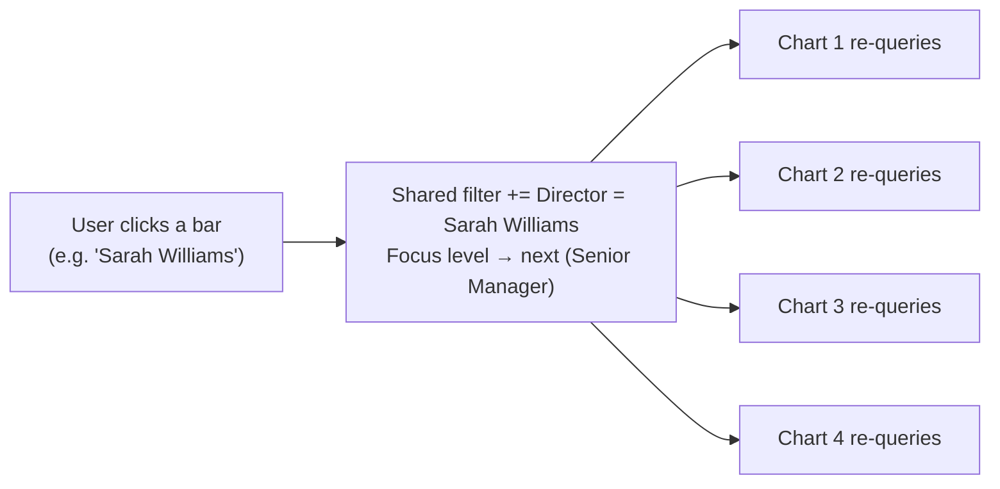
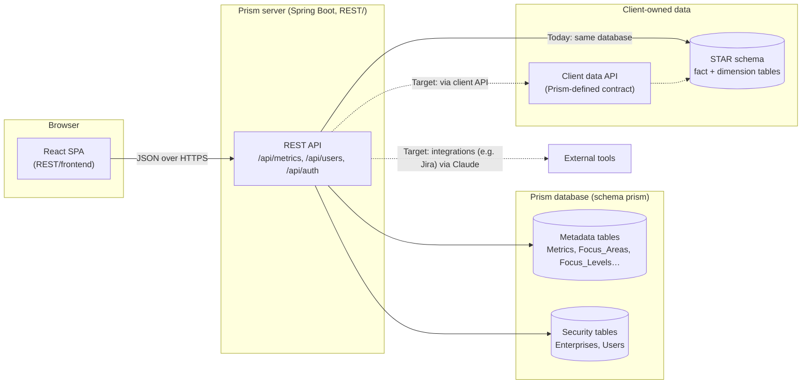
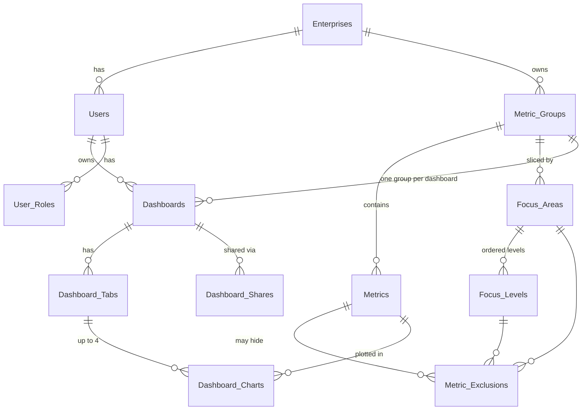
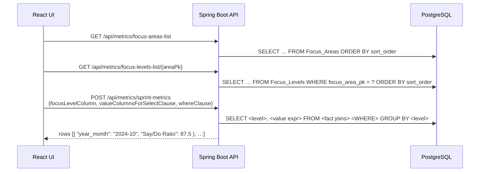

# Prism — Product & Architecture Overview

> **Read this first.** It explains what Prism is for, the ideas the code is built around, and how the
> pieces fit together. Developer guides for each part go deeper:
> [UI developer guide](../frontend/docs/DEVELOPER_GUIDE.md) · [API codebase guide](../CLAUDE.md)
>
> Throughout this document, **Today** describes the code as it exists now and **Target** describes the
> agreed design it is moving toward. The current code is a working prototype of one metric.

---

## 1. What Prism is

Prism is a **metrics and analytics engine with a reusable presentation layer** for team-based software
delivery metrics: DORA metrics, Say/Do ratio, velocity and velocity variance, scope churn, MTTR, MTTD,
WIP, and so on.

The core idea: **adding a new metric should not require new screens or new API endpoints.** A developer
supplies the data (in a STAR schema) and describes it in Prism's **metadata tables**; the existing UI and
API then display it with full drill-down and slice-and-dice across whatever dimensions the metric has.

This forces both the backend and the frontend to be **generic**: neither knows about "sprints" or
"teams" in code. They read what to query and how to group it from metadata.

## 2. Key concepts

| Concept | Meaning | Example |
|---|---|---|
| **Metric** | A value computed from fact data, defined by a SQL expression. | Say/Do Ratio = completed ÷ committed story points |
| **Metric Group** *(target)* | Metrics that share the same fact and dimension tables, and therefore the same ways to slice them. | "Team sprint metrics": Say/Do, Velocity, Scope Churn |
| **Focus Area** | A dimension you can slice by. | Time, Organization |
| **Focus Level** | One level within a focus area; the chart groups by it. Levels are ordered top-down (`sort_order`). | Time: Year → Quarter → Month → Sprint |
| **Filter** | A "level = value" condition, e.g. *Director = Sarah Williams*. Filters combine with AND. | |
| **Drill-down** | Clicking a bar adds that bar as a filter **and** moves to the next focus level. | Click "2024 Q4" → filter on it, now showing its months |
| **Dashboard / Tab / Chart** *(target)* | A user's saved layout: tabs of up to 4 charts, shareable with other users. | |
| **Enterprise** | A client organization (tenant). Users belong to one enterprise. | |

### How drill-down feels to a user

Drill-down is a **multi-dimensional filter**. Each click narrows the data *and* goes one level deeper,
so a user can go from the whole company to one manager's teams in a few clicks, or switch focus area
(e.g. from Organization to Time) and keep the filters already chosen.

**Target:** drill-down applies to the **whole dashboard tab**, not one chart. Clicking a bar on any chart
updates the shared filter, and every chart on the visible tab re-queries together, so the user sees an
entire view change at once for "Sarah Williams' org in Q4 2024".



**Today:** there is one chart on one page; drill-down works exactly this way for that chart.

## 3. Architecture



| Part | Technology | Where |
|---|---|---|
| UI | React 19 + TypeScript, Vite, Bootstrap 5, Chart.js | `REST/frontend/` — built into `REST/src/main/resources/static/` |
| API | Spring Boot 3.5, Java 21, `JdbcTemplate` (raw SQL) | `REST/src/main/java/com/prism/` |
| Database | PostgreSQL, schema `prism` | DDL in `prism/SQL/` (numbered, re-runnable migration scripts) |

The UI and API ship as **one jar**: Spring Boot serves the built UI and the API from the same address.

| Environment | Address |
|---|---|
| Local (developer machine) | `http://localhost:8080/` (UI dev server: `http://localhost:5173/`) |
| Test | TBD |
| Production | TBD |

All `localhost` addresses in Prism documentation refer to a local installation only.

## 4. Data model

Prism has two kinds of tables.

### 4.1 Data tables (client-owned)

Fact and dimension tables in a **STAR schema**. The implementor may name tables and columns anything
(within Postgres rules) — the metadata tells Prism how to use them. **Target:** they live outside the
`prism` schema, in a client-owned schema or database, reached either directly or through a client API
that implements a contract Prism defines.

**Today (demo data):** three tables in the `prism` schema serve as the prototype data set:

| Table | Holds |
|---|---|
| `Sprint_Metrics_Fact` | One row per team per sprint, with numerator/denominator pairs (never pre-computed percentages) |
| `Sprint_Dim` | Sprint, month, quarter, year attributes |
| `Team_Dim` | Team plus up to 7 organizational levels (`level_1_name` … `level_7_name`) |

#### Rule: store numerators and denominators, never percentages

Fact rows must store a ratio's **numerator and denominator as separate columns** (e.g.
`committed_story_points_completed` and `committed_story_points`), never a pre-computed percentage.
The percentage is always calculated in the metric's SELECT expression from the **sums** of both columns
over the rows being grouped:

```sql
ROUND(SUM(smf.committed_story_points_completed)::DECIMAL
      / SUM(smf.committed_story_points)::DECIMAL * 100, 2)   -- correct: ratio of sums
```

Averaging stored percentages (`AVG(say_do_pct)`) gives an *average of averages*, which is wrong as soon
as rows differ in size. Example — two teams in the same month:

| Team | Completed | Committed | Team % |
|---|---|---|---|
| A | 9 | 10 | 90% |
| B | 10 | 40 | 25% |
| **Org** | **19** | **50** | **38%** correct (ratio of sums) vs **57.5%** wrong (average of 90% and 25%) |

Because every drill-down level re-aggregates the same fact rows (team → manager → director → company,
sprint → month → year), only the ratio-of-sums form gives the right answer at every level.
This applies to every ratio metric a client adds (Say/Do, % Estimated, Estimate Changed, …).

### 4.2 Metadata tables (Prism-owned)

Static, reusable tables that describe each metric so the generic UI and API can serve it.

**Today:**

| Table | Purpose |
|---|---|
| `Metrics` | Per metric: name, value expression (`valuecolumnsforselectclause`) and FROM/JOIN clause (`fromclause`). *Not yet read by the API — the UI still sends the expression.* |
| `Focus_Areas` | Slicing dimensions, ordered by `sort_order`. |
| `Focus_Levels` | Levels within each area: display `name`, the dimension `column_name` to group/filter by, and `sort_order` (drill-down order). |
| `Enterprises` | Tenants. Includes the client API `url`/`auth_token`. |
| `System_Settings` | One row per enterprise: enterprise-specific settings, currently how long a temporary password stays valid (default 72 hours). Edited under Admin → System Settings. |
| `Users` | Login accounts (UUID `user_id`, bcrypt hash, lockout fields), each in an enterprise. |

**Target (agreed direction, not yet built):**



Key rules of the target design:

- **Everything is enterprise-scoped.** Every metadata row belongs to an enterprise, and the server takes
  the enterprise from the signed-in user — never from the request.
- **Metric Groups** are the parent of both Metrics and Focus Areas. Metrics in a group share the same
  fact/dimension joins (the FROM clause likely moves to the group), so they share focus areas and levels.
- **Opt-out exclusions:** a metric uses every focus area and level of its group unless an exclusion row
  hides a specific area or level for that metric.
- **One metric group per dashboard,** so every chart on a tab understands the same filter columns and
  dashboard-wide drill-down stays coherent.
- **Role-based access:** only trusted roles (e.g. metrics admin) may change metadata; dashboards can be
  shared with other users in the same enterprise.

## 5. How a chart gets its data

**Today:**



The UI currently sends **SQL fragments** (the value expression and the WHERE clause), which the API runs.
This is a known security gap (see §6).

**Target:** the UI sends only **identifiers and values** — metric, focus level, and filters as
`{focus level, value}` pairs. The API looks up the SQL in the metadata (trusted, admin-maintained),
validates that every level belongs to the metric's group, and binds filter values as query parameters.
That one change makes the API generic *and* closes the injection risk.

## 6. Security model

| Area | Today | Target |
|---|---|---|
| Login | Email + password checked against a bcrypt hash; 5 failed attempts lock the account for 15 minutes. New users and admin resets get a **randomly generated temporary password**, unique to the user, shown once to the admin (with Copy) and stored only as a hash. It expires after the enterprise's configured hours (default 72; enforced by the API at login), and must be changed at the next sign-in (UI-enforced). There is deliberately no shared default password: one known password would open every account that hasn't signed in yet (CWE-1393). | Same, plus a real session or token issued by the server, which also enforces the password change. |
| API access | **Not authenticated.** Any caller can use every endpoint; the UI just hides pages when signed out. | Every request authenticated; enterprise and roles derived from the session. |
| Authorization | None. | Roles (e.g. viewer, dashboard author, metrics admin, enterprise admin). |
| Tenant isolation | User administration is scoped to the signed-in user's enterprise **in the UI only** (the API trusts the enterprise sent by the browser). | All metadata and data queries scoped to the user's enterprise by the server. Super-users can switch enterprise with a picker; lists never mix enterprises. |
| Metric queries | Client sends SQL fragments (injection risk). | Client sends IDs/values; SQL comes from metadata; values bound as parameters. |
| Secrets | `Enterprises.auth_token` stored as plain text; DB credentials in `application.properties`. | Encrypted or in a secrets store; never returned by the API. |
| Auditing | Logins, user changes and password changes written to `logs/audit.log`. | Same, plus the acting user once authentication exists. |

The UI's own security rules are covered in the [UI developer guide](../frontend/docs/DEVELOPER_GUIDE.md#7-security).

## 7. Status

| Capability | Status |
|---|---|
| One metric (Say/Do Ratio) with drill-down across Time and Organization | **Working** |
| Login, change password, forced change of temporary passwords | **Working** (API unauthenticated — see §6) |
| User administration: list (deactivated hidden), add/edit in modals, deactivate (no delete), reset to temporary password | **Working** |
| Generated temporary passwords with expiry; System Settings page (per enterprise: temporary password validity) | **Working** (SQL/010) |
| Focus area / level ordering via `sort_order` | **Working** (SQL/009) |
| API reads metric SQL from the `Metrics` table | Planned |
| Metric Groups, exclusions, enterprise scoping | Planned (design agreed, tables not yet created) |
| Dashboards, tabs (≤ 4 charts), sharing | Planned |
| Dashboard-wide drill-down across charts | Planned (single-chart version works today) |
| Server-side sessions, roles, tenant isolation | Planned |
| Client-owned data schema / client data API contract | Planned |
| External integrations (e.g. Jira) via Claude | Planned |

## 8. Where to go next

- **Working on the UI?** → [UI developer guide](../frontend/docs/DEVELOPER_GUIDE.md)
- **Working on the API?** → [API codebase guide](../CLAUDE.md): source map, endpoints, conventions, backlog
- **Changing the database?** → add the next numbered, re-runnable script in `prism/SQL/` (see the API guide's conventions)
