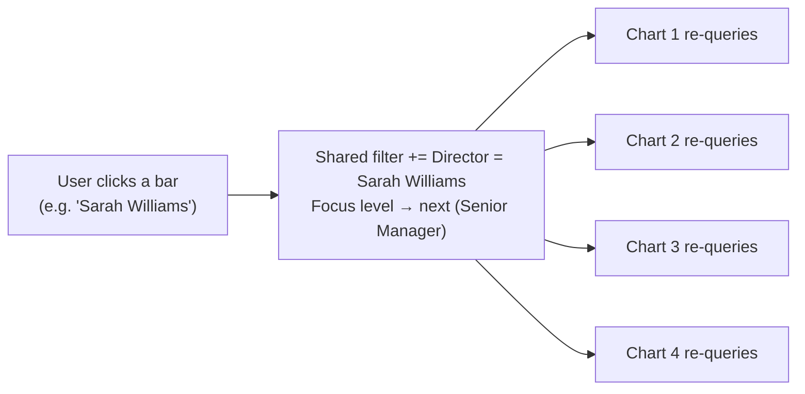
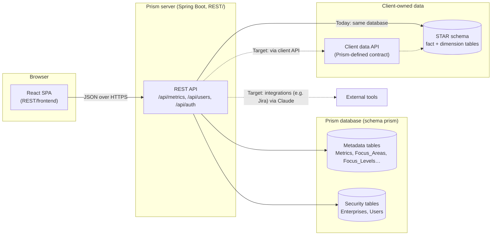
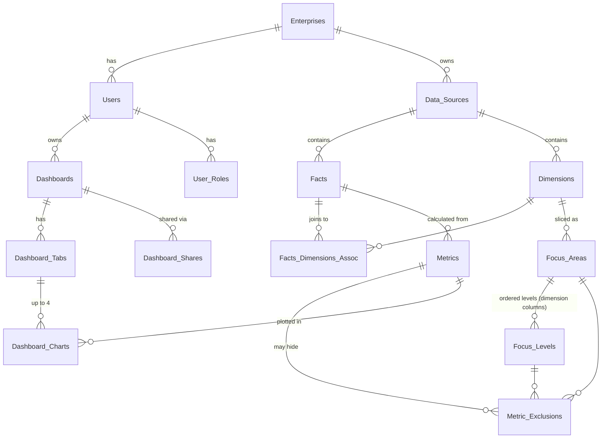
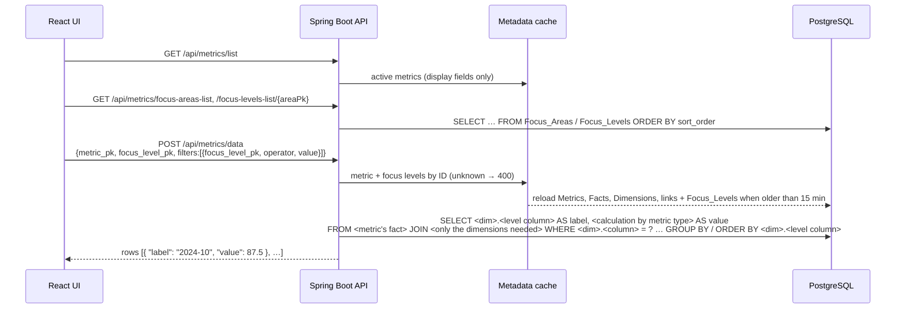

# Prism — Product & Architecture Overview

> **Read this first.** It explains what Prism is for, the ideas the code is built around, and how the
> pieces fit together. Developer guides for each part go deeper:
> [UI developer guide](../frontend/docs/DEVELOPER_GUIDE.md) · [API codebase guide](../CLAUDE.md)
>
> Throughout this document, **Today** describes the code as it exists now and **Target** describes the
> agreed design it is moving toward. The current code is a working prototype: five demo metrics with drill-down,
> user administration, and the first version of the Prism Advisor (MCP).

---

## 1. What Prism is

Prism is a **metrics and analytics engine with a reusable presentation layer** for team-based software
delivery metrics: DORA metrics, Say/Do ratio, velocity and velocity variance, scope churn, MTTR, MTTD,
WIP, and so on.

The core idea: **adding a new metric should not require new screens or new API endpoints.** A developer
supplies the data (in a STAR schema) and describes it in Prism's **metadata tables**; the existing UI and
API then display it with full drill-down and slice-and-dice across whatever dimensions the metric has.

This forces both the backend and the frontend to be **generic**: neither knows about "sprints" or
"teams" in code. They read what to query and how to group it from metadata.

## 2. Key concepts

| Concept | Meaning | Example |
|---|---|---|
| **Metric** | A value computed from fact data, defined by a SQL expression. | Say/Do Ratio = completed ÷ committed story points |
| **Fact** *(target; table `Facts`)* | The data a set of metrics is calculated from, plus the dimensions it joins to. In practice it plays the role of a "metric group": metrics on the same fact table can be sliced the same ways. | `Sprint_Metrics_Fact`: Say/Do, Velocity, Scope Churn |
| **Focus Area** | A dimension you can slice by. | Time, Organization |
| **Focus Level** | One level within a focus area; the chart groups by it. Levels are ordered top-down (`sort_order`). | Time: Year → Quarter → Month → Sprint |
| **Filter** | A "level = value" condition, e.g. *Director = Sarah Williams*. Filters combine with AND. | |
| **Drill-down** | Clicking a bar adds that bar as a filter **and** moves to the next focus level. | Click "2024 Q4" → filter on it, now showing its months |
| **Dashboard / Tab / Chart** *(target)* | A user's saved layout: tabs of up to 4 charts, shareable with other users. | |
| **Enterprise** | A client organization (tenant). Users belong to one enterprise. | |

### How drill-down feels to a user

Drill-down is a **multi-dimensional filter**. Each click narrows the data *and* goes one level deeper,
so a user can go from the whole company to one manager's teams in a few clicks, or switch focus area
(e.g. from Organization to Time) and keep the filters already chosen.

**Target:** drill-down applies to the **whole dashboard tab**, not one chart. Clicking a bar on any chart
updates the shared filter, and every chart on the visible tab re-queries together, so the user sees an
entire view change at once for "Sarah Williams' org in Q4 2024".



**Today:** there is one chart on one page; drill-down works exactly this way for that chart.

## 3. Architecture



| Part | Technology | Where |
|---|---|---|
| UI | React 19 + TypeScript, Vite, Bootstrap 5, Chart.js | `REST/frontend/` — built into `REST/src/main/resources/static/` |
| API | Spring Boot 3.5, Java 21, `JdbcTemplate` (raw SQL) | `REST/src/main/java/com/prism/` |
| Database | PostgreSQL, schema `prism` | DDL in `prism/SQL/` (numbered, re-runnable migration scripts) |

The UI and API ship as **one jar**: Spring Boot serves the built UI and the API from the same address.

| Environment | Address |
|---|---|
| Local (developer machine) | `http://localhost:8080/` (UI dev server: `http://localhost:5173/`) |
| Test | TBD |
| Production | TBD |

All `localhost` addresses in Prism documentation refer to a local installation only.

### 3.1 Hosting and deployments (target — agreed Oct 2026)

- **Separate deployments per cloud provider, capped at two or three providers** (e.g. AWS, Azure). Each
  deployment is a complete Prism: app plus its own metadata database. Separate regions (for data residency) work
  the same way.
- **Each enterprise lives in exactly one deployment** — the one in the same cloud as its data, so that
  private network links are possible (§4.3). A sign-in page that routes users to the right deployment can come later.
- **Stay cloud-neutral** so another deployment is configuration, not a port:
  - plain PostgreSQL (available as a managed service on AWS, Azure and Google Cloud — avoid provider-only
    extensions);
  - one Spring Boot jar (later a container image), identical in every deployment;
  - secrets read through one small interface, with one implementation per provider (AWS Secrets Manager,
    Azure Key Vault, Google Secret Manager) — the only provider-specific piece.

## 4. Data model

Prism has two kinds of tables.

### 4.1 Data tables (client-owned)

Fact and dimension tables in a **STAR schema**. The implementor may name tables and columns anything
(within Postgres rules) — the metadata tells Prism how to use them.

**Target (agreed Oct 2026): client STAR data never lives in the Prism database.** Each client hosts its
own STAR schema (e.g. in its own cloud account), and Prism reaches it as a *data source* (§4.3). The only
STAR schema allowed inside the Prism database is the demo/prototype one, and even that is registered as an
ordinary data source, so it uses the same code path as a client's.

#### Rule: one row per combination of the lowest-level dimensions (owner, Oct 2026)

A fact table's grain is the combination of the lowest level of each of its dimensions: the demo has exactly one row
per sprint and team; a fact with five dimensions has one row per five-way combination.

- **No duplicates**, ever (a unique key on the dimension keys).
- **Gaps are allowed and mean N/A, never zero.** A team that first appears in sprint 6 has no rows for sprints 1–5.
  Prism must never fill missing combinations with zeros: no bar, no contribution to sums or ratios, skipped by
  averages. Any future feature that lines up series (dashboards, "what drives this?", period comparisons) must keep
  gaps as gaps. A real zero (the team existed and delivered nothing) is a stored row of zeros.

**Today (demo data):** three tables in the `prism` schema serve as the prototype data set:

| Table | Holds |
|---|---|
| `Sprint_Metrics_Fact` | One row per team per sprint, with numerator/denominator pairs (never pre-computed percentages) |
| `Sprint_Dim` | Sprint, month, quarter, year attributes |
| `Team_Dim` | Team plus up to 7 organizational levels (`level_1_name` … `level_7_name`) |

#### Rule: store numerators and denominators, never percentages

Fact rows must store a ratio's **numerator and denominator as separate columns** (e.g.
`committed_story_points_completed` and `committed_story_points`), never a pre-computed percentage.
The percentage is always calculated in the metric's SELECT expression from the **sums** of both columns
over the rows being grouped:

```sql
ROUND(SUM(smf.committed_story_points_completed)::DECIMAL
      / SUM(smf.committed_story_points)::DECIMAL * 100, 2)   -- correct: ratio of sums
```

Averaging stored percentages (`AVG(say_do_pct)`) gives an *average of averages*, which is wrong as soon
as rows differ in size. Example — two teams in the same month:

| Team | Completed | Committed | Team % |
|---|---|---|---|
| A | 9 | 10 | 90% |
| B | 10 | 40 | 25% |
| **Org** | **19** | **50** | **38%** correct (ratio of sums) vs **57.5%** wrong (average of 90% and 25%) |

Because every drill-down level re-aggregates the same fact rows (team → manager → director → company,
sprint → month → year), only the ratio-of-sums form gives the right answer at every level.
This applies to every ratio metric a client adds (Say/Do, % Estimated, Estimate Changed, …).

### 4.2 Metadata tables (Prism-owned)

Static, reusable tables that describe each metric so the generic UI and API can serve it.

**Today:**

| Table | Purpose |
|---|---|
| `Metrics` | The only definition of a metric (SQL/012): type (percentage, ratio, average, sum), numerator/value and denominator column expressions, optional row condition, title, unit, decimals, y-axis scale, order, active flag. Read by the API (cached); the UI gets display fields only. |
| `Focus_Areas` | Slicing dimensions, ordered by `sort_order`. |
| `Focus_Levels` | Levels within each area: display `name`, the dimension `column_name` to group/filter by, and `sort_order` (drill-down order). |
| `Enterprises` | Tenants. Includes the client API `url`/`auth_token`. |
| `System_Settings` | One row per enterprise: enterprise-specific settings, currently how long a temporary password stays valid (default 72 hours). Edited under Admin → System Settings. |
| `Users` | Login accounts (UUID `user_id`, bcrypt hash, lockout fields), each in an enterprise. |

**Target (agreed direction, not yet built):**



Key rules of the target design:

- **Everything is enterprise-scoped.** Every metadata row belongs to an enterprise, and the server takes
  the enterprise from the signed-in user — never from the request.
- **No Metric Groups (decided Oct 2026).** The fact table plays that role: metrics on the same fact table share
  its dimensions, so they can be sliced the same ways. A grouping entity can be added later if a real need appears.
- **Focus areas come from dimensions.** A focus area is defined on a dimension table, and its focus levels are
  columns of that dimension (§4.3). The focus areas a metric offers are worked out, not stored: every focus area
  whose dimension is linked to the metric's fact table.
- **Display order and drill-down are separate (decided Oct 2026).** Focus levels are client-defined (they depend on
  the client's dimensions).
  - `sort_order` is only the order levels appear in pickers.
  - Drill-down is defined by a **pointer from each level to the next level down** (`drill_to_focus_level_pk`). A
    focus area can hold several drill paths. The demo's Time area has two (owner, Oct 2026): **with the year**, Year →
    Year & Quarter → Year & Month → Year & Sprint, and **without it**, Quarter → Month → Sprint ("Month (all years)"
    and so on). A level with no pointer doesn't drill: clicking its bar adds the filter and stays on that level.
  - **Label and key are separate columns (decided Oct 2026).** A level's **label** column is the text a bar shows
    ("Sprint 9", "Jan"); it needn't be unique. Its optional **key** column is what Prism groups, sorts and filters
    by, unique per bar ("2026 Sprint 09", `sprint_start_date`, `2026-01`); each key has one label. Without a key, the
    label is the key. So bars sort correctly (Sprint 2 before Sprint 10), and a drill-down filter on "Sprint 9" means
    that bar's sprint, not every Sprint 9. Working since step 1e (SQL/018): the API returns `{key, label, value}` and
    filters by key. Demo Time levels (owner, Oct 2026): labels are Year "2024", Year & Quarter "Q4 2024", Year & Month "Dec 2024",
    Year & Sprint "Sprint 26 2024" (SQL/019: across years a sprint label needs its year), Quarter "Q4", Month "Dec",
    and the all-years Sprint level "Sprint 26" (each bar combines that sprint number from every year).
  - Rules checked on save and when the cache loads: the next level is in the same focus area, and there are no loops.
  - Admin UI: two reorderable lists per focus area — **display order**, and **drill-down order** with an "excluded"
    box beside it for levels not on the drill path. The drill list writes the pointers; per-level drill targets
    (branching paths) are possible later without a schema change.
- **Exclusions are opt-out.** A metric offers every one of those focus areas and levels unless an exclusion row
  hides a specific area or level for that metric.
- **Dashboards may mix fact tables that share dimensions.** A dashboard offers only the focus areas that all
  of its charts support, so dashboard-wide drill-down filters mean the same thing on every chart. The common
  case is a single fact table. This is derived from the fact–dimension links, so it needs no extra tables.
- **Role-based access:** only trusted roles (e.g. metrics admin) may change metadata; dashboards can be
  shared with other users in the same enterprise.

### 4.3 Data sources and the STAR model (target — agreed Oct 2026)

Metric SQL is never typed as a whole query. Implementors describe their STAR schema once, and each metric
then only supplies its calculation. Prism writes every FROM, JOIN, GROUP BY and WHERE itself.

Table names (owner, Oct 2026): `Data_Sources`, `Facts`, `Dimensions`, `Facts_Dimensions_Assoc` (the `_Assoc` suffix
marks an association table).

| Entity (table) | Describes |
|---|---|
| **Data Source** (`Data_Sources`) | Where a STAR schema lives and how Prism connects (see below); read-only credentials kept in a secrets store, never in a table. Database connection columns and API connection columns are separate; exactly one of the two must be filled (no separate type column). |
| **Fact** (`Facts`) | A fact table in a data source: table name and alias. |
| **Dimension** (`Dimensions`) | A dimension table in a data source: table name and alias. Shared by any number of facts. |
| **Fact–dimension link** (`Facts_Dimensions_Assoc`) | Association table: which dimensions a fact joins to, and on which columns. Prism builds the JOINs from these. (A fact joining the same dimension twice, e.g. two date roles, would need a role name; not needed yet.) |
| **Metric** | A fact table (metrics can share one), the **calculation**, an optional metric-level **condition** (e.g. only completed sprints), and display settings (title, legend, y-axis maximum, number format). |
| **Focus Level** | Points to a dimension column (instead of holding a free-text column name). Grouping and drill-down filters can only use known columns. |

**Metric types (decided Oct 2026).** Every metric has a type that tells Prism how to calculate it. The admin
names the columns (simple column expressions such as `smf.a + smf.b`) and, optionally, a **row condition** ("only
rows where…") that is applied to every part of the calculation, so the numerator and denominator always cover the
same rows. Prism writes the SQL:

| Type | Admin provides | Prism calculates | Display defaults | Example |
|---|---|---|---|---|
| **Percentage** | numerator, denominator | `SUM(num) / NULLIF(SUM(den), 0) × 100` | `%`, axis 0–100 | Say/Do, % Estimated, Scope Churn, Commitment Strength (condition: trailing average present) |
| **Ratio** | numerator, denominator | `SUM(num) / NULLIF(SUM(den), 0)` | no unit, fit to data | points per story |
| **Average** | value | `AVG(value)`: average per fact row; rows without a value are ignored, not counted as zero | fit to data | Velocity per team-sprint |
| **Sum** | value | `SUM(value)` | fit to data | total points; "sprints with zero churn" = value `1`, condition `added + removed = 0` |

- All four re-aggregate the raw fact rows at every drill-down level, so none of them averages averages (§4.1).
- A zero denominator gives an empty value (no bar), not an error.
- There is no Count type: it is a Sum of `1` with a condition. Add one only if a use case doesn't fit.
- Metric-specific information (calculation, title, legend, unit, decimals, scale) lives **only** in the `Metrics`
  table. The UI is generic and gets display fields — never SQL — from the API.

**Y-axis scaling (decided Oct 2026).**
- **Defaults:**
  - Percentage: 0–100, so values read relative to 100%. If any value exceeds 100, the top becomes a round number
    just above the highest value.
  - Other types: 0 to a round number just above the highest value.
- **Metric default:** an admin can override the default per metric: 0–100, fit to data, or fixed minimum/maximum.
- **User control on the chart:** a Scale control with **0–100** (percentages), **Fit to data**, or **Custom** (minimum
  and/or maximum, to look past severe outliers). Remembered for the session; saved per chart once dashboards exist.
- **Outliers are never dropped.** A bar beyond the maximum is drawn to the top edge with a **barber-pole (striped)
  top** so it can't be mistaken for a true-height bar. Its **real value is shown on hover** (tooltips always show the
  true value).
- **Raised minimum:** a minimum above 0 is flagged on the chart ("Axis starts at 60"), and active custom bounds are
  shown beside the Scale control.
- **Scaling is visual only;** it never changes the calculated values.

**Writing a calculation.**
- **Custom type (later): a free-form expression** for anything the four types can't express, in a restricted pseudo-SQL. Allowed:
  - columns of the metric's fact table and its linked dimensions (`alias.column`);
  - numbers, text values, arithmetic and `CASE`;
  - an allowed list of functions (`SUM`, `COUNT`, `AVG`, `MIN`, `MAX`, `ROUND`, `COALESCE`, `NULLIF`, `CAST`, …).

  Anything else is rejected (subqueries, other tables or schemas, unknown functions, `;`, comments). Prism
  enforces this by **parsing** the expression (e.g. with JSqlParser), not by searching the text.
- The column expressions and row conditions of the four types follow the same rules.
- Calculations are written by **enterprise metrics admins**. The admin screens must state clearly what is and
  isn't allowed, and why.
- AI review (e.g. through MCP) may help explain errors or spot a calculation that looks wrong, but it is **advice
  only**. The parser's allow-list is the security gate, because AI judgement is probabilistic and the text it
  reviews could be written to mislead it.

**Validation and feedback for metrics admins** (instead of showing raw database errors):
1. **On every edit, before running anything:** parse the expression and check it against the known columns and
   allowed functions. Give precise messages:
   - "Unknown column `smf.commited_story_points` — did you mean `committed_story_points`?" (Prism knows the
     real columns, see *schema reading* below);
   - "`pg_sleep` isn't an allowed function";
   - the location of a syntax error;
   - "wrap `smf.x` in an aggregate such as SUM".
2. **Test:** dry-run the generated query on the read-only connection with a time limit and a row limit.
   Translate common database errors into advice:
   - division by zero → use the Ratio template or NULLIF;
   - "must appear in GROUP BY" → wrap the column in SUM/COUNT/AVG;
   - type mismatch → the column is text but the calculation needs a number;
   - timeout → check the joins.

   Anything unrecognized: a short message plus a "Details" section with the raw error — admins only, never
   regular users.
3. **Preview:** the first rows grouped by the top focus level, with sanity warnings:
   - every value is empty;
   - many rows have a zero denominator;
   - values exceed the y-axis maximum.
4. **View SQL** shows the complete generated query, so admins can run it in their own SQL tool. Later, an
   **import** option could take a pasted full query (the way the original 25+ metrics were built: write
   and test the whole query, then split it up) and break it into fact table, joins, calculation and
   condition for the admin to confirm.

**Schema reading.** With a data-source connection, Prism can list the client's tables and columns from the
database catalog (and suggest joins from foreign keys). Admins pick from lists instead of typing names, and
the validator knows every valid column.

**Connecting to a client's data source** (e.g. a STAR schema in the client's AWS account), without exposing it
to the internet:

| Option | How | When |
|---|---|---|
| **1. Firewall allow-list** | Database accepts connections only from Prism's fixed outgoing IP addresses (on AWS: a NAT gateway with Elastic IPs). | Default; works from any deployment. |
| **2. Private network link** | AWS PrivateLink / Azure Private Link / Google Private Service Connect: the client exposes only the database to Prism's network; no public address, no internet traffic. | Enterprise clients in the same cloud as their Prism deployment (§3.1). |
| 3. Outbound-only agent *(only if demanded)* | A small connector inside the client's network dials out to Prism (like the Power BI gateway); nothing inbound is opened. Lighter variant: SSH tunnel through a client bastion. | On-premises or very strict networks. |

Every connection, whatever the option:
- **TLS** with certificate verification;
- **a read-only login** that can read only the STAR tables (ideally only views the client chooses to expose);
- **a statement time limit set on that login**, on the client's side;
- **credentials in a secrets store**, never returned by the API;
- **an audit record** of the queries Prism ran against each data source.

The data-source record says which option it uses, so a deployment can refuse one it can't reach.

**Client APIs as a second phase (decided Oct 2026).** The main path is a direct read-only connection to the
client's externally hosted database. Later, if revenue justifies it, a metric's data source may instead be a
**client-run service** that implements Prism's metric-data request/response contract. In that case the client
writes and runs the SQL, and Prism's STAR model isn't used for that metric.

To keep that possible without building it now:
- the metric-data request stays ID-based and source-neutral: metric, focus level, and filters with an operator;
- the server reaches data through one "metric data provider" seam, with the database connection as the only
  implementation for now;
- a data source has separate database and API connection columns, exactly one of them filled (database now, API later).

## 5. How a chart gets its data

**Today (since SQL/012):**



The UI sends only **identifiers and values**. The API takes every piece of SQL from the metadata (trusted,
admin-maintained) and binds filter values as query parameters, so the request can't inject SQL.
Proven identical to the previous behaviour on the demo data: 24,160 metric × level × filter combinations,
120,580 result rows, 0 differences.

**Since step 1c (SQL/016, Oct 2026)** the FROM/JOIN comes from the metadata too: the metric's fact table
(`Metrics.fact_pk`), plus a JOIN for each dimension the query needs: the grouping level's, the filters', and any
dimension whose alias the metric's expressions use. Joins are INNER, so every fact row needs its dimension row (a
foreign key; `review_star_schema` rule S4). Proven identical to the hard-coded demo clause before it was deleted:
21,050 cases and 191,423 rows on the demo data, 5,320 cases on the hand-checked dataset, 0 differences.

**Data providers (step 1d):** the service reaches chart data only through a `MetricDataProvider`, chosen by the
metric's data source (`Data_Sources` connection method). The request it gets is source-neutral (metric, focus level,
filters), so a client-run API can implement the same seam later. Today the only provider is `prism_database` (the
demo schema, on Prism's own connection); a data source with another method is refused with a clear message.

**Still to come:** a provider for client databases with a read-only login and a time limit (roadmap #3); metric expressions are checked only for `;` and comments until the
allow-list parser exists.

## 6. Security model

| Area | Today | Target |
|---|---|---|
| Login | Email + password checked against a bcrypt hash; 5 failed attempts lock the account for 15 minutes. New users and admin resets get a **randomly generated temporary password**, unique to the user, shown once to the admin (with Copy) and stored only as a hash. It expires after the enterprise's configured hours (default 72; enforced by the API at login), and must be changed at the next sign-in (UI-enforced). There is deliberately no shared default password: one known password would open every account that hasn't signed in yet (CWE-1393). | Same, plus a real session or token issued by the server, which also enforces the password change. |
| API access | **Not authenticated.** Any caller can use every endpoint; the UI just hides pages when signed out. | Every request authenticated; enterprise and roles derived from the session. |
| Authorization | None. | Roles (e.g. viewer, dashboard author, metrics admin, enterprise admin). |
| Tenant isolation | User administration is scoped to the signed-in user's enterprise **in the UI only** (the API trusts the enterprise sent by the browser). | All metadata and data queries scoped to the user's enterprise by the server. Super-users can switch enterprise with a picker; lists never mix enterprises. |
| Metric queries | Client sends only IDs and values; the server builds all the SQL, FROM/JOIN included, from cached metadata (`Metrics`, `Facts`, `Dimensions`, `Focus_Levels`) and binds filter values (SQL/012, SQL/016). Runs on the Prism database's connection; metric expressions only guarded against `;` and comments. | Client sends only IDs and values (metric, focus level, filters with an `operator`, initially "equals" only). The server builds all SQL from cached metadata (refreshed every 15 minutes; unknown IDs rejected), binds values as parameters, and runs it on the data source's read-only login with a time limit (§4.3). Metric calculations are parsed and checked against an allow-list. |
| Client data sources | Demo data in the Prism database. | No client STAR data in the Prism database; read-only, TLS, allow-listed or private-link connections; credentials in a secrets store (§4.3). |
| Secrets | `Enterprises.auth_token` stored as plain text; DB credentials in `application.properties`. | In the deployment's secrets store (per cloud provider, §3.1); never returned by the API. |
| Auditing | Logins, user changes and password changes written to `logs/audit.log`. | Same, plus the acting user once authentication exists. |

The UI's own security rules are covered in the [UI developer guide](../frontend/docs/DEVELOPER_GUIDE.md#7-security).

## 7. Status

| Capability | Status |
|---|---|
| Five metrics (Say/Do, Velocity, Scope Churn, Estimate Changed, % Estimated) defined only in the `Metrics` table, with a metric picker and drill-down across Time and Organization | **Working** (SQL/012) |
| Login, change password, forced change of temporary passwords | **Working** (API unauthenticated — see §6) |
| User administration: list (deactivated hidden), add/edit in modals, deactivate (no delete), reset to temporary password | **Working** |
| Generated temporary passwords with expiry; System Settings page (per enterprise: temporary password validity) | **Working** (SQL/010) |
| Focus area / level ordering via `sort_order` | **Working** (SQL/009) |
| API builds metric SQL from the `Metrics` table by metric type; UI sends IDs only | **Working** (SQL/012) |
| Y-axis Scale control (0–100 / fit / custom) with barber-pole outliers | Planned (per-metric default scale works today) |
| Drill-down pointers (`drill_to_focus_level_pk`), several paths per area | **Working** (SQL/015, step 1d): the UI drills by the pointer; a level without one only adds the filter |
| Label vs key columns per focus level | **Working** (SQL/015, SQL/018, step 1e): charts group, sort and filter by the key and show the label (e.g. "Sprint 26" with key 2024-12-23) |
| Data sources / fact & dimension model, exclusions, enterprise scoping | **In progress:** `Data_Sources`, `Facts`, `Dimensions`, `Facts_Dimensions_Assoc` created and seeded with the demo schema (SQL/013), not yet used by the query builder; exclusions and enterprise scoping planned |
| Dashboards, tabs (≤ 4 charts), sharing | Planned |
| Dashboard-wide drill-down across charts | Planned (single-chart version works today) |
| Server-side sessions, roles, tenant isolation | Planned |
| Client-owned data schema / client data API contract | Planned |
| External integrations (e.g. Jira) via Claude | Planned |
| Prism Advisor (MCP) phase 1: guides and metric catalog, `search_metric_catalog` / `draft_metric` / `review_star_schema`, three guided prompts | **Built** (local only, off by default; content in owner review — [MCP.md](MCP.md) §7) |
| Community library, metadata setup assistant, "what drives this?" analysis | Vision (§8; ROADMAP #8, #9, #11) |

## 8. Prism Advisor and community library (vision — discussed Oct 2026, not yet designed in detail)

Clients can look up what experts say about improving a metric, but general advice often doesn't match their
business, their ways of working or their data. The **Prism Advisor** is an AI assistant, delivered as an MCP
server, that helps clients get value out of Prism. It covers which metrics address a struggle, how to calculate
them, how to design Prism-compatible fact and dimension tables, and which behaviors actually drive the outcomes
they care about, checked against their own data. Over time it learns from the whole client community.
Technical design (where the MCP server runs, its resources, tools and prompts, safety rules, phases):
[MCP.md](MCP.md).

### 8.1 What the Advisor does

| MCP part | Examples |
|---|---|
| **Resources** (reference content) | Metric catalog: problem addressed, Prism type, numerator/denominator, required fact columns, pitfalls. Guides: STAR schema for Prism, metric types, drill-down design, improvement paths (§8.3). |
| **Tools** (definite answers) | `review_star_schema(ddl)`: Prism-compatibility findings (stored percentages, unclear grain, missing dimension keys, hierarchy columns that can't become focus levels, NULL handling). `draft_metric(...)`: a ready `Metrics` row plus the exact SQL Prism would run (the real `MetricQueryBuilder`). Later: `submit_insight` (§8.2). |
| **Prompts** (guided workflows) | "Pick metrics for my team's struggle"; "Design my fact and dimension tables"; "Review my schema before connecting it to Prism". |

Its value over a general AI is Prism's own rules (§4.1–4.3): ratio of sums, metric types, grain, focus levels as
dimension columns. The checks give definite answers rather than plausible ones. The Advisor needs no access to
client data. A later **Analyst** server (querying a client's metrics through Prism's normal data-source
connection) depends on authentication (§6).

### 8.2 Community library: give to get

- **What's shared:** knowledge about *using* data, never the data itself. That means ways to calculate a metric
  (there are always several) and their trade-offs; ways to organize dimensions; which dimensions suit which
  metrics; pitfalls; improvement paths and their prerequisites; and findings about which behaviors drive which
  outcomes, as direction and strength across clients ("in 7 of 9 contributing clients, branch age moved ahead of
  change failure rate by about one sprint"), never any client's values.
- **Your fact data is always your fact data.** No raw data, no identifying numbers, no names.
- **Give to get (owner decision):** clients who contribute get the community library; clients who decline are
  walled off from it. The AI still helps them as much as it can, with Prism's own content but without the
  collective knowledge.
- **Base layer for everyone:** Prism-authored content (catalog, guides, checks) is part of the product. Only the
  community layer is gated, so a client who declines is never worse off than with a general AI.
- **How knowledge enters:** (1) capture: at the end of a useful session the assistant proposes an insight, and
  the user sees exactly what would be shared and approves it; (2) curation: a review queue where submissions are
  generalized, anonymized and checked for correctness (the owner curates at first); (3) publish to the catalog.
  Curation is what keeps wrong advice from spreading. Automatic contribution: once a client opts in, aggregated
  usage signals (which metric patterns get kept, changed or retired) count, with no extra effort.
- **Enterprise-private knowledge:** a client's own definitions, decisions and reasons, available immediately
  within that enterprise only.
- **Open questions:** exact contract wording for "contribute"; whether published lessons remain after a client
  leaves (normally yes, since they are anonymized); a minimum contribution quality; a paid option for clients
  whose policies forbid sharing; seeding the library (cold start) and terms for founding clients.

### 8.3 Improvement paths: "it's never just one thing"

Software delivery is a tapestry of practices that work best when no threads are missing, so the Advisor
recommends **ordered improvement paths**, not single practices:

- **Levels:** some improvements help almost any team; others only help on that foundation and can backfire
  without it. Example: small batches and frequent releases are death to a team that relies on manual testing,
  because significant changes go out without enough testing.
- **Order of focus for quality** (owner): (1) test quality, (2) test coverage, (3) integration and batch size:
  few concurrently open branches and short branch life (real continuous integration, not trunk-based on paper),
  then small batches and frequent releases.
- **Readiness from the team's own data:** where the team is now, the next step it is ready for, and the threshold
  that shows it can move on (e.g. don't push batch size until automated coverage of changed code is steady and
  escaped defects are falling). Warn when one thread is pulled without the others ("release frequency doubled,
  automated testing hasn't moved").
- **Test quality stand-ins:** mutation score, escaped defects in covered code, flaky-test rate. Test quality is
  hard to measure objectively; together these make it trackable.
- **Practices as dimensions:** each team's working practices (share of automated vs manual testing, branching,
  review, release process) belong in the dimension design, as team attributes that change over time, so analyses
  can split by them.

### 8.4 Planned analysis: "what drives this?"

Pick an outcome (e.g. change failure rate, Sev1/Sev2 incidents per month); Prism calculates candidate behavior
metrics at the same grain (team × sprint or month) with the existing metric engine and ranks them by how strongly
they move with the outcome.

- **Within each team over time** (big teams don't just correlate with big numbers), **with time lags** (does this
  month's branch age come before next month's failures?), with strength and amount of supporting data shown.
- **Conditional effects:** split by the working-practice dimensions. A single overall correlation can hide
  opposite effects that cancel out (frequent releases help teams with strong automated tests and hurt
  manual-testing teams, so overall "no effect").
- Always states that correlation isn't causation; the strongest evidence is a known change ("Team 7 moved to
  short-lived branches in March: before and after").
- Needs the fact/dimension model (shared dimensions across fact tables; incidents as their own fact, attributed to
  a team or service and a period, with consistent severity).

### 8.5 Metric gotchas to teach (examples)

- **Count vs rate:** "reduce failed deployments" should mean change failure rate (failed ÷ total). Chasing the
  count makes teams deploy less, so changes get bigger and riskier.
- **Coverage as a target** gets gamed (tests that run code without checking it). Pair it with test-quality stand-ins.
- **Percentiles (median, p90) can't be averaged:** Team A merged 20 branches in 1 day each, Team B 1 branch in
  30 days. The average of the medians is 15.5 days, but the real median is 1 day. Same over time: sprint p90s
  averaged over a quarter aren't the quarter's p90. Planned fix: a **Percentile** metric type (value column,
  percentile, optional row condition) computed over raw rows with `PERCENTILE_CONT(p) WITHIN GROUP (ORDER BY …)`
  at every drill-down level. It needs one fact row per item (e.g. per branch). "Average team p90" is a different,
  legitimate metric when the team is the unit, and should be named that way. Today: "% of branches merged within
  1 day" (Percentage with a row condition) works and re-aggregates correctly; average branch age works but is
  skewed by forgotten branches.
- **Branch measures:** decide when a branch starts (creation or first commit), exclude release and environment
  branches, handle abandoned branches, map repositories to teams. Concurrently open branches need a daily
  snapshot fact (average of daily counts).

### 8.6 Build order (after the fact/dimension model)

1. Advisor with an owner-curated catalog and the schema/metric checks; standalone value, no network effects needed.
2. Capture (`submit_insight`) and a curation queue in Prism.
3. Enterprise-private knowledge, and community access rules (give to get), once authentication exists (§6).
4. Usage-based evidence, once there are enough clients.
5. "What drives this?" analysis, and the Percentile metric type.

Hosting: a central service (shared library, accounts), not only a local server. The read side (catalog and
guides) could be open, even to prospects; the write side needs authentication and enterprise scoping.
Implementation: see [MCP.md](MCP.md).

## 9. Where to go next

- **What's next?** → [Roadmap](ROADMAP.md): the to-do list, in order
- **MCP server (Advisor / Analyst)?** → [MCP design](MCP.md)
- **Working on the UI?** → [UI developer guide](../frontend/docs/DEVELOPER_GUIDE.md)
- **Working on the API?** → [API codebase guide](../CLAUDE.md): source map, endpoints, conventions, backlog
- **Changing the database?** → add the next numbered, re-runnable script in `prism/SQL/` (see the API guide's conventions)
