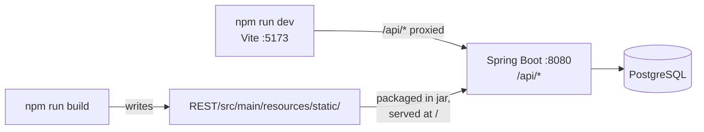
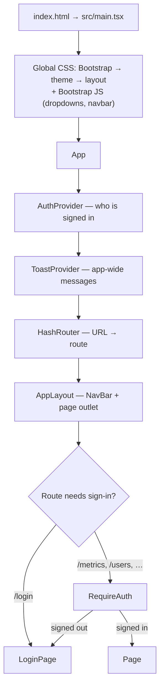
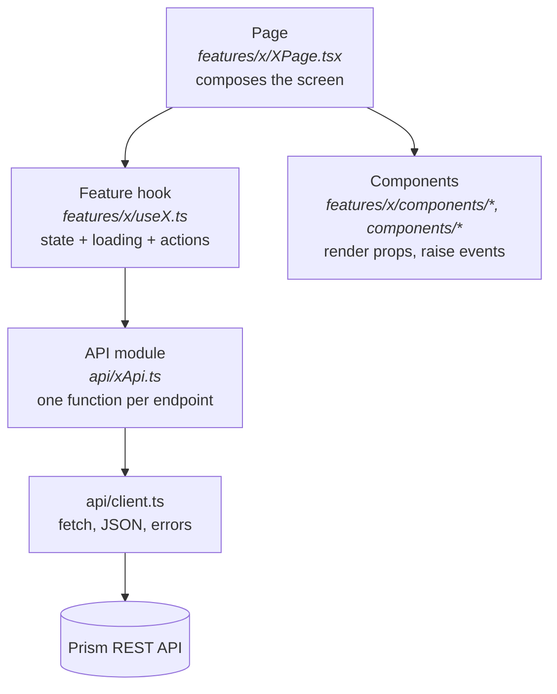
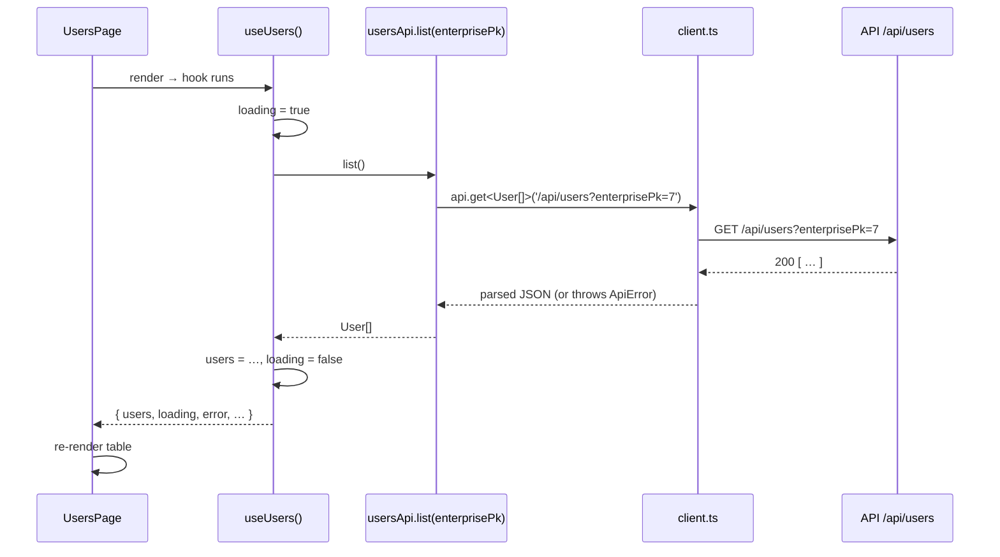

# Prism UI — Developer Guide

Everything you need to understand, run and extend the Prism web UI (`REST/frontend/`).
Read time: about 30 minutes. New to Prism itself? Read the
[product & architecture overview](../../docs/OVERVIEW.md) first (10 minutes).

**Contents**

1. [Start here](#1-start-here)
2. [How the app works](#2-how-the-app-works)
3. [Project map](#3-project-map)
4. [Adding a new page](#4-adding-a-new-page)
5. [Other common tasks](#5-other-common-tasks)
6. [Styling and theme](#6-styling-and-theme)
7. [Security](#7-security)
8. [Build, quality checks and troubleshooting](#8-build-quality-checks-and-troubleshooting)
9. [Reference](#9-reference)

This guide assumes you know React basics (components, props, `useState`/`useEffect`) and can read
TypeScript. Everything Prism-specific is explained here.

---

## 1. Start here

### What the UI is

A single-page app for exploring Prism metrics with drill-down, plus login and user administration.

| | |
|---|---|
| Framework | React 19 + TypeScript (strict) |
| Build tool | Vite |
| Routing | React Router 7, **hash routes** (`/#/metrics`) |
| Styling | Bootstrap 5 + the purple/black theme |
| Charts | Chart.js via `react-chartjs-2` |
| Backend | Prism REST API (Spring Boot) under `/api` |

### Run it

These instructions are for a **local installation**; addresses for test and production environments are
TBD. Requires Node.js 20+, and the API running locally on `http://localhost:8080` (see `REST/run.sh`).

```bash
cd REST/frontend
npm install        # first time only
npm run dev        # http://localhost:5173 — hot reload; /api is proxied to :8080
```

To build the full application (UI + API jar) from `REST/`: `./build.sh`, then `./run.sh` and open
`http://localhost:8080/` (local only).

### Five files to read first

| File | Why |
|---|---|
| `src/App.tsx` | Every page and how it is protected — the whole app on one screen. |
| `src/api/client.ts` | How all HTTP calls are made and how errors look. |
| `src/features/metrics/useMetricsExplorer.ts` | The drill-down logic — the heart of Prism. |
| `src/features/metrics/MetricsPage.tsx` | How a page is assembled from a hook and components. |
| `src/auth/AuthProvider.tsx` | What "signed in" means in the UI. |

---

## 2. How the app works

### 2.1 Where the UI runs



- **Development:** Vite serves the UI with hot reload and forwards `/api/*` to the API.
- **Production:** `npm run build` writes the bundle into Spring Boot's `static/` folder; the API jar
  serves the UI and the API from the same origin. That folder is build output — **never edit it**.
- All API URLs are **relative** (`/api/...`), so the same build works in any environment — local,
  test or production (addresses TBD) — without changing UI code or configuration. What *does* differ per
  environment is server-side: the API's allowed CORS origins (`CorsConfig.java`, currently only
  `http://localhost:8080`) and database settings.

### 2.2 Startup: from `index.html` to a page



The providers wrap everything, so any component can call `useAuth()` or `useToast()`.

### 2.3 The four layers

Every feature is split into the same four layers. **Data flows down, events flow up.**



| Layer | Owns | Must not |
|---|---|---|
| **Page** | Layout of the screen; wiring hook output into components. | Call `fetch`, hold business logic. |
| **Feature hook** | State, loading/error flags, calls to API modules, toasts. | Render markup. |
| **Components** | Rendering what they are given via props; calling `on…` callbacks. | Call the API or read global state (except `useToast`/`useAuth` where noted). |
| **API module** | One typed function per endpoint. | Know about React. |

Why: each layer can be read, tested and changed on its own. A new page is mostly "a new hook + a few
components", reusing everything else.

### 2.4 A request, end to end

What happens when the Users page loads:



Errors: `client.ts` throws an `ApiError` (status + body) for any non-2xx response. Hooks catch it and
either set an `error` string (shown with `<ErrorAlert>`) or show a warning toast.

### 2.5 Worked example: one bar click on the metrics page

This is Prism's core interaction. Files involved: `MetricBarChart.tsx` → `ChartPanel.tsx` →
`MetricsPage.tsx` → `useMetricsExplorer.ts` → `metricsApi.ts`.

1. The user clicks the bar **"Sarah Williams"** while the focus level is **Director**.
2. `MetricBarChart`'s Chart.js `onClick` finds the bar's label and calls `onBarClick("Sarah Williams")`.
3. That prop is `explorer.drillDown`, from `useMetricsExplorer`. It:
   - adds the filter `{ name: "Director", column_name: "level_2_name", value: "Sarah Williams" }`
     (or warns "Filter already exists");
   - moves `selectedLevel` to the **next level** in `focusLevels` (the API returns them in drill-down
     order, `sort_order`), or warns "No deeper level available";
   - remembers that level for this focus area, so switching areas and back returns to it.
4. Because `selectedLevel` and `filters` changed, the hook's data effect re-runs:
   `buildWhereClause(filters)` produces `WHERE level_2_name = 'Sarah Williams'` and
   `metricsApi.getSprintMetrics(...)` posts it with the new level column.
5. Rows arrive → `rows` state updates → the chart re-renders grouped by the new level. Any previous,
   still-running request was cancelled by the effect's `AbortController`.

Changing the focus area keeps the active filters: that is how a user "rotates" the same selection
(e.g. Sarah's org) onto another dimension (e.g. Time).

> **Target design:** this state will move up from the page to the **dashboard tab**, so one click
> re-queries up to four charts at once. Keep that in mind: chart components should stay "dumb"
> (rows + callbacks in, nothing else), which they are today.

---

## 3. Project map

```
frontend/
├── index.html                  Vite entry; loads src/main.tsx
├── vite.config.ts              /api proxy (dev) and build output → ../src/main/resources/static
├── package.json                scripts: dev, build, typecheck, lint, preview
├── docs/DEVELOPER_GUIDE.md     this file
├── prototypes/                 old single-file app + experiments (not built; see its README)
└── src/
    ├── main.tsx                global CSS/JS imports, renders <App/>
    ├── App.tsx                 providers + route table
    ├── api/                    ── the only code that talks HTTP
    │   ├── client.ts           api.get/post/put/delete, ApiError, isAbortError, errorMessage
    │   ├── types.ts            shapes of API JSON (FocusArea, User, AuthResult, …)
    │   ├── metricsApi.ts       /api/metrics/*
    │   ├── usersApi.ts         /api/users/*
    │   ├── settingsApi.ts      /api/settings/*
    │   └── authApi.ts          /api/auth/* (returns the JSON body on 400/401 instead of throwing)
    ├── auth/                   ── session state
    │   ├── AuthProvider.tsx    holds the login response; persists it (localStorage "prism_auth")
    │   ├── AuthContext.ts      context type
    │   ├── useAuth.ts          { session, userId, signIn, signOut }
    │   ├── authStorage.ts      load/save/clear the stored session
    │   └── RequireAuth.tsx     route guard → /login
    ├── components/             ── reusable, feature-agnostic UI
    │   ├── layout/             AppLayout (NavBar + page), NavBar
    │   ├── toast/              ToastProvider, useToast, ToastContext
    │   ├── DropdownSelect.tsx  Bootstrap dropdown that behaves like a <select>
    │   ├── Modal.tsx           accessible dialog (Esc, focus trap, portal); render to open, unmount to close
    │   ├── ErrorAlert.tsx
    │   └── LoadingSpinner.tsx
    ├── features/               ── one folder per screen/domain
    │   ├── metrics/            MetricsPage, useMetricsExplorer, metricDefinitions, filters, components/
    │   ├── users/              UsersPage, useUsers, userList (filter/sort), temporaryPassword, format,
    │   │                       components/ (UsersTable, UserRow, AddUserModal, EditUserModal, TemporaryPasswordNotice)
    │   ├── settings/           SystemSettingsPage (Admin → System Settings), useSystemSettings, validHours
    │   └── auth/               LoginPage, ChangePasswordPage
    ├── theme/                  purple-black-theme.css (Bootstrap overrides), palette.ts (chart colours)
    └── styles/layout.css       page layout (split view, narrow pages, toast position)
```

**Naming and code conventions**

- Components and pages: `PascalCase.tsx`, one exported component per file, **named exports**
  (`export function UsersPage()`); only `App` is a default export.
- Hooks: `useSomething.ts`. Contexts: `SomethingContext.ts` + `SomethingProvider.tsx` + `useSomething.ts`.
- API modules: `somethingApi.ts`, exporting one object (`usersApi`) with one function per endpoint.
- API field names stay as the server sends them (`focus_area_pk`, `is_active`) — don't rename in the UI.
- Put a type in `api/types.ts` if it describes server JSON; otherwise keep it next to the code using it.

---

## 4. Adding a new page

We'll build a small read-only **Teams** page that lists teams from a (hypothetical) `GET /api/teams`
endpoint. The same nine steps apply to any page.

> **Before you build a page for a new metric:** you shouldn't need one. New metrics are meant to plug
> into the existing metrics/dashboard screens through database metadata
> (see the [overview](../../docs/OVERVIEW.md#2-key-concepts)). Build pages for genuinely new
> *functions* (administration, settings, dashboards…).

**Backend first.** The endpoint must exist. Follow the API conventions in
[`REST/CLAUDE.md`](../../CLAUDE.md#conventions-agreed): a controller method (with `log.debug("Started")`
and `PerformanceLog.time(...)`), a service method, SQL in a text-block constant, bound parameters only.

### Step 1 — Describe the JSON (`src/api/types.ts`)

```ts
export interface Team {
  team_pk: number;
  team_name: string;
  level_1_name: string | null;
}
```

### Step 2 — Add the API module (`src/api/teamsApi.ts`)

```ts
import { api } from './client';
import type { Team } from './types';

export const teamsApi = {
  list: (signal?: AbortSignal) => api.get<Team[]>('/api/teams', { signal }),
};
```

Rules: relative path starting `/api/`; pass `signal` through for anything loaded in an effect;
encode path segments with `encodeURIComponent`.

### Step 3 — Write the feature hook (`src/features/teams/useTeams.ts`)

```ts
import { useEffect, useState } from 'react';
import { errorMessage, isAbortError } from '../../api/client';
import { teamsApi } from '../../api/teamsApi';
import type { Team } from '../../api/types';

export function useTeams() {
  const [teams, setTeams] = useState<Team[]>([]);
  const [loading, setLoading] = useState(true);
  const [error, setError] = useState<string | null>(null);

  useEffect(() => {
    const controller = new AbortController();
    teamsApi
      .list(controller.signal)
      .then(setTeams)
      .catch((e) => {
        if (!isAbortError(e)) setError(`Failed to load teams: ${errorMessage(e)}`);
      })
      .finally(() => {
        if (!controller.signal.aborted) setLoading(false);
      });
    return () => controller.abort(); // cancel if the user leaves the page
  }, []);

  return { teams, loading, error };
}
```

For pages that change data, follow `features/users/useUsers.ts`: each action calls the API, reloads,
shows a success toast, and returns an `ActionOutcome` (`{ ok, message }`) so the modal or form that
started it can show a failure message next to the fields.

### Step 4 — Build the components (`src/features/teams/components/TeamsTable.tsx`)

```tsx
import type { Team } from '../../../api/types';

export function TeamsTable({ teams }: { teams: Team[] }) {
  return (
    <table className="table table-dark table-hover align-middle">
      <thead>
        <tr><th>Team</th><th>Level 1</th></tr>
      </thead>
      <tbody>
        {teams.map((t) => (
          <tr key={t.team_pk}>
            <td>{t.team_name}</td>
            <td>{t.level_1_name ?? '—'}</td>
          </tr>
        ))}
      </tbody>
    </table>
  );
}
```

Components get data and callbacks through props only. Reuse `components/` (`LoadingSpinner`,
`ErrorAlert`, `DropdownSelect`) before writing new ones.

### Step 5 — Assemble the page (`src/features/teams/TeamsPage.tsx`)

Every data page handles three states: **loading, error, empty** — then the content.

```tsx
import { ErrorAlert } from '../../components/ErrorAlert';
import { LoadingSpinner } from '../../components/LoadingSpinner';
import { TeamsTable } from './components/TeamsTable';
import { useTeams } from './useTeams';

export function TeamsPage() {
  const { teams, loading, error } = useTeams();

  return (
    <div className="container py-3 w-100">
      <div className="card shadow-purple">
        <div className="card-header"><h6 className="mb-0">Teams</h6></div>
        <div className="card-body">
          {loading ? (
            <LoadingSpinner />
          ) : error ? (
            <ErrorAlert message={error} />
          ) : teams.length === 0 ? (
            <p className="text-muted">No teams found.</p>
          ) : (
            <TeamsTable teams={teams} />
          )}
        </div>
      </div>
    </div>
  );
}
```

### Step 6 — Register the route (`src/App.tsx`)

Put it **inside** the `RequireAuth` route unless the page must be reachable while signed out (only
`/login` is):

```tsx
<Route element={<RequireAuth />}>
  <Route path="/metrics" element={<MetricsPage />} />
  <Route path="/users" element={<UsersPage />} />
  <Route path="/teams" element={<TeamsPage />} />          {/* new */}
  <Route path="/change-password" element={<ChangePasswordPage />} />
</Route>
```

The URL becomes `/#/teams`. Hash routes mean no server configuration is needed.

### Step 7 — Add it to the navigation (`src/components/layout/NavBar.tsx`)

Add a `<Link>` inside the relevant `NavDropdown` (or a new one):

```tsx
<NavDropdown title="Admin">
  <li><Link className="dropdown-item" to="/users">Users</Link></li>
  <li><Link className="dropdown-item" to="/teams">Teams</Link></li>   {/* new */}
  …
</NavDropdown>
```

Always use `<Link to>` / `useNavigate()` for in-app navigation, never `<a href="#/…">` or `window.location`.

### Step 8 — User feedback

- Background failures: set `error` and render `<ErrorAlert>`.
- Results of a user action: `const { showToast } = useToast();` then
  `showToast('Team saved', 'success')` (`'info' | 'success' | 'warning'`).
- Disable buttons while saving (`disabled={saving}`) to prevent double submits.

### Step 9 — Check it

```bash
npm run typecheck && npm run lint && npm run dev
```

Then exercise: signed-out access redirects to login; loading spinner; error state (stop the API);
empty state; normal state.

### Checklist

- [ ] Endpoint exists and follows the API conventions (bound parameters, logging, timing)
- [ ] Types added to `api/types.ts`
- [ ] Functions added to an `api/*Api.ts` module (no `fetch` anywhere else)
- [ ] Feature folder `features/<name>/` with `<Name>Page.tsx`, `use<Name>.ts`, `components/`
- [ ] Effects pass an `AbortSignal` and ignore `isAbortError`
- [ ] Page handles loading / error / empty states
- [ ] Route added inside `RequireAuth` (unless deliberately public)
- [ ] Nav link added
- [ ] Toasts for action results; buttons disabled while busy
- [ ] No `dangerouslySetInnerHTML`, no secrets, no client-side-only security (see §7)
- [ ] `npm run typecheck` and `npm run lint` pass

---

## 5. Other common tasks

### Add a metric to the chart (today)

Until the API reads metric definitions from the database, a metric is described in
`src/features/metrics/metricDefinitions.ts`:

```ts
export const VELOCITY: MetricDefinition = {
  key: 'Velocity',                 // SQL alias the API returns the value under
  title: 'Velocity',
  legendLabel: 'Story points per sprint',
  max: undefined,                  // auto-scale
  formatTick: (v) => `${v}`,
  selectSql: 'ROUND(AVG(smf.story_points_completed), 1) as "Velocity"',
};
```

Then pass it to `useMetricsExplorer` / `ChartPanel` in `MetricsPage.tsx`. This file goes away once
metric metadata moves server-side (see the overview, §5) — don't build more on it than necessary.

### Add a form

Copy the pattern in `features/users/components/AddUserModal.tsx` or `features/auth/ChangePasswordPage.tsx`:
controlled inputs with `useState`, `<label htmlFor>` for every input, validate in `handleSubmit`, show a
message with `alert-warning`, disable the submit button while saving, and call a hook action that
returns an `ActionOutcome`.

### Add a dialog (add / edit pattern)

Prism's standard for creating and editing records is **a read-only list plus a modal**, as on the Users
page: an "+ Add …" button opens an add modal; clicking a row (or its edit icon) opens an edit modal.
Use `components/Modal.tsx`:

```tsx
{open && (
  <Modal
    title="Add team"
    onClose={() => setOpen(false)}
    footer={<>
      <button type="button" className="btn btn-outline-secondary" onClick={() => setOpen(false)}>Cancel</button>
      <button type="submit" form="add-team-form" className="btn btn-primary">Add team</button>
    </>}
  >
    <form id="add-team-form" onSubmit={handleSubmit} noValidate>…</form>
  </Modal>
)}
```

Render it to open, stop rendering it to close. The modal handles Esc, focus (moves in, stays in, returns
on close) and `aria` labelling; clicking the backdrop deliberately does nothing so typed data isn't lost.
Prefer deactivation over deletion for anything other records may refer to (users never get deleted).

### Add a reusable component

Put it in `src/components/` only if it has **no feature knowledge** (no API calls, no Prism-specific
types). Otherwise keep it in `features/<name>/components/`.

### Add an API call to an existing feature

Add a function to the feature's `api/*Api.ts` module and any new types to `api/types.ts`, then call it
from the feature hook. Endpoints that answer failures with a JSON body (like the auth endpoints) can use
`ApiError.json()` to read it — see `authApi.ts`.

---

## 6. Styling and theme

| To change… | Edit |
|---|---|
| Colours, cards, forms, dropdowns, tables (app-wide) | `src/theme/purple-black-theme.css` (Bootstrap overrides via `--bs-*` variables and classes) |
| Chart colours | `src/theme/palette.ts` — Chart.js draws on a canvas and can't read CSS variables; keep it in sync with the CSS |
| Page layout (sidebar width, chart height, toast position) | `src/styles/layout.css` |
| A single component's look | Prefer Bootstrap utility classes (`mb-3`, `d-flex`, `text-muted`) in the JSX |

**Buttons:** use only the variants the theme styles — `btn-primary` (main action: Save, Add, confirm),
`btn-secondary` / `btn-outline-secondary` (Cancel and secondary actions) and `btn-outline-primary`.
Bootstrap's other variants (`btn-warning`, `btn-danger`, `btn-info`, `btn-success` and their outline
forms) are not themed and render in default Bootstrap colours. Coloured badges and alerts for status
(e.g. `text-bg-warning` "Temp password") are fine.

Import order in `main.tsx` matters: Bootstrap → theme → layout. Dropdowns and the mobile navbar use
Bootstrap's own JavaScript through `data-bs-toggle` attributes (imported once in `main.tsx`).

---

## 7. Security

**The most important rule: the UI is not a security boundary.** Anything the browser does can be
bypassed by calling the API directly. Hiding a page or a button is a convenience, never protection.
Real protection must be enforced by the API.

### 7.1 What the UI does today

| Mechanism | Where | What it does |
|---|---|---|
| Login | `features/auth/LoginPage.tsx`, `api/authApi.ts` | Posts email + password to `/api/auth/login`; the server checks the bcrypt hash and locks the account after 5 failures. |
| Session | `auth/AuthProvider.tsx`, `auth/authStorage.ts` | Stores the login response (`{ success, user }`) in `localStorage` under `prism_auth`. Logout deletes it. |
| Route guard | `auth/RequireAuth.tsx` | Redirects to `/login` when there is no session, then returns the user to the page they wanted. |
| Output escaping | React | All text rendered with `{…}` is escaped, which prevents script injection (XSS). |
| Password rules | `features/auth/ChangePasswordPage.tsx` | Minimum 8 characters and confirmation match — repeated by the server. |
| Temporary passwords | `auth/RequireAuth.tsx`, `features/auth/LoginPage.tsx`, `features/users/components/TemporaryPasswordNotice.tsx` | The server generates a random temporary password for new users and admin resets; the UI shows it once (Copy button) and never stores it. A user signed in with one is held on Change Password until they choose a new one; after the enterprise's validity period the API refuses it. |
| Enterprise scoping | `features/users/useUsers.ts` | The Users page lists and creates users only in the signed-in user's enterprise (`useAuth().enterprisePk`). |
| No hard-coded hosts | `api/client.ts` | Relative `/api` URLs; same origin in production, proxy in development. |

### 7.2 Known gaps (be aware; don't build on them)

| Gap | Consequence | Tracked as |
|---|---|---|
| The API has **no authentication**. | Anyone who can reach the server can call every endpoint; `RequireAuth` only hides pages. | API backlog #5 |
| The session is just the stored login response — **no token**. | Editing `localStorage` "signs you in" to the UI; change-password trusts the `X-User-ID` header. | API backlog #5 |
| The metrics page sends **SQL fragments** (`selectSql`, WHERE clause). | A crafted request can run arbitrary SQL. | API backlog #1; fix is in the overview §5 |
| No roles. | Every signed-in user sees Admin → Users. | Target design |
| Enterprise and temp-password rules are enforced only in the UI. | The API accepts any `enterprisePk` and doesn't block a user with a temporary password. | API backlog #5 |

When real authentication arrives, expect: a token or session cookie sent by `client.ts` on every
request, `useAuth()` exposing roles, and `RequireAuth` accepting a required role. Pages written with the
rules below will need no changes beyond that.

### 7.3 Rules for new code

1. **Never rely on the UI for authorization.** If only admins may do something, the API must check it.
   Hide UI controls for convenience, in addition to — never instead of — the server check.
2. **Never render raw HTML.** No `dangerouslySetInnerHTML`; no building HTML strings. Render data as
   text in JSX.
3. **Never send SQL or SQL-like strings from new code.** Send IDs and values; let the server build the
   query from trusted metadata. (The existing metrics screen is the only exception, pending its fix.)
4. **No secrets in the bundle.** Anything in `src/` ends up readable in the browser — API keys,
   passwords, tokens, internal URLs included. Configuration that must stay private belongs on the server.
5. **All HTTP goes through `src/api/`.** One place to add authentication headers, error handling and
   auditing later.
6. **Don't store sensitive data in `localStorage`** beyond the session; never store passwords.
7. **Don't log sensitive data** with `console.log` (passwords, tokens, personal data); remove debug
   logging before committing.
8. **Validate on both sides.** Client-side validation is for a quick, friendly message; the server must
   validate again.
9. **Encode values in URLs** with `encodeURIComponent` when building paths.
10. **Use `<Link>`/`useNavigate` for navigation** and never navigate to a URL taken from user input or
    query strings without checking it is an in-app path.

---

## 8. Build, quality checks and troubleshooting

### Scripts (`frontend/`)

| Command | What it does |
|---|---|
| `npm run dev` | Dev server on :5173 with hot reload and the `/api` proxy. |
| `npm run typecheck` | TypeScript in strict mode (also run by `build`). |
| `npm run lint` | ESLint with TypeScript and React-hooks rules. |
| `npm run build` | Type-check, then write the production bundle to `../src/main/resources/static/` (**that folder is emptied first**). |
| `npm run preview` | Serve the production build locally. |

From `REST/`, `./build.sh` runs `npm install`, `npm run build` and `mvn clean package` in the right
folders.

### Troubleshooting

| Symptom | Likely cause / fix |
|---|---|
| Every API call fails in `npm run dev` | The API isn't running on :8080. Start it (`REST/run.sh`). |
| Page is blank after a deploy | The UI wasn't built before `mvn package`. Use `./build.sh`. |
| `…/users` gives 404 (e.g. `http://localhost:8080/users`) | Use hash URLs: `/#/users`. |
| A dropdown doesn't open | Missing `data-bs-toggle="dropdown"`, or Bootstrap JS import removed from `main.tsx`. |
| Chart colours ignore a theme change | Update `src/theme/palette.ts` too (§6). |
| "Failed to fetch focus areas" / "…focus levels" (HTTP 500) | The database is missing script `SQL/009` (the API sorts by `sort_order`). |
| React warning about missing `key` | Give list items a stable key from the data (`user_id`, `team_pk`), not the array index. |
| Effect runs twice in development | Expected: React StrictMode. Effects must clean up (abort requests). |

---

## 9. Reference

**Glossary**

| Term | Meaning |
|---|---|
| Focus area | A dimension to slice by (Time, Organization). |
| Focus level | A level within a focus area (Year, Month…). The chart groups by it; `sort_order` defines drill-down order. |
| Filter | `level = value` condition; filters combine with AND and persist when you change focus area. |
| Drill-down | Bar click → add filter + move to the next focus level. |
| Session | The stored login response (`prism_auth` in `localStorage`). |

**Related documents**

- [Product & architecture overview](../../docs/OVERVIEW.md) — what Prism is, data model, security model, roadmap
- [API codebase guide](../../CLAUDE.md) — server source map, endpoints, conventions, backlog
- [`frontend/README.md`](../README.md) — quick start
- [`prototypes/README.md`](../prototypes/README.md) — the old single-file app and experiments
